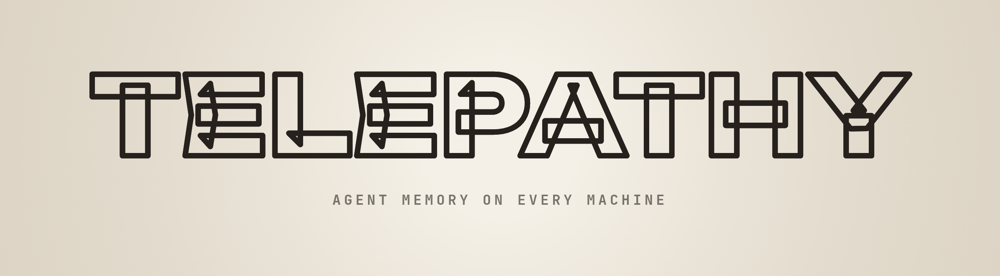

# Telepathy

Your coding agent's memory, on every machine.

Claude Code remembers what you teach it, but only on the machine where you taught it,
and only inside the project folder where it happened. Telepathy turns memory into
**bundles** you choose per project:

```
tp init                          # once per machine: connect your private memory repo
tp use personal my-project       # per project, per machine: pick the bundles it loads
tp add github:someone/grpo-notes # install someone else's knowledge
```

Then just open Claude Code. It pulls the latest memories from your other machines and
loads the bundles you chose as one memory. New memories go back into the right bundle and
get pushed when the session ends.

- **Bundles, not one blob.** Your personal rules, a project's memory and a shared knowledge
  bundle, combined in one session.
- **Every machine.** Linux, macOS and Windows. Git moves the memories; no server to run.
- **Shareable.** A bundle is a folder of markdown in a git repo. Install one like a package.
- **Native.** Claude Code still sees ordinary auto memory: always loaded, plain files.

> Status: **v0.1 in progress.** Works on Linux with Claude Code (tested on 2.1.283)
> and Codex CLI (0.171).
> Windows is written but not yet tested. Sharing (`tp add`, `tp publish`) comes in v0.2.
> Design: [docs/design.md](docs/design.md).

## Try it (from source)

```
uv tool install git+https://github.com/Zine-Elabidine/telepathy   # gives `tp`
tp init git@github.com:you/my-memories.git   # an empty private repo, or omit for local-only
cd ~/code/my-project
tp import ~/.claude/projects/<this-project>/memory my-project   # optional: bring existing memories
tp use personal my-project
tp status
```

Start a new Claude Code session in that project. `tp hooks --remove` undoes the hooks
(`tp init` also keeps a copy of your settings as `settings.json.before-telepathy`).

## Codex

```
tp hooks --codex
```

This adds two hooks to `~/.codex/hooks.json` and lets Codex's sandbox write to `~/.telepathy`
(appended to `~/.codex/config.toml`, with a backup). Codex runs a new hook only once you trust
it: open Codex, type `/hooks` and approve the two Telepathy hooks. From then on every Codex
session in a project gets the same memory as Claude Code there, with the rules for saving to
it; what Codex saves is pushed when the session ends. `tp hooks --codex --remove` undoes it.

## Other agents

Claude Code and Codex are wired up through hooks. Any other agent can use the same memory
through one call at its start and one at its end:

```
tp session start [--cwd DIR]   # pull, rebuild; prints JSON: folder, index, bundles, write, personal
tp session end [--cwd DIR]     # file stray memories, regenerate indexes, commit, push in the background
```

The agent loads `index` once at its start, reads memory files under `folder`, and saves a new
memory as `<folder>/<bundle>/<name>.md`: user and feedback memories in `personal`, project
and reference ones in `write`. [Diwan](https://github.com/Zine-Elabidine/diwan) does this.

## License

MIT
